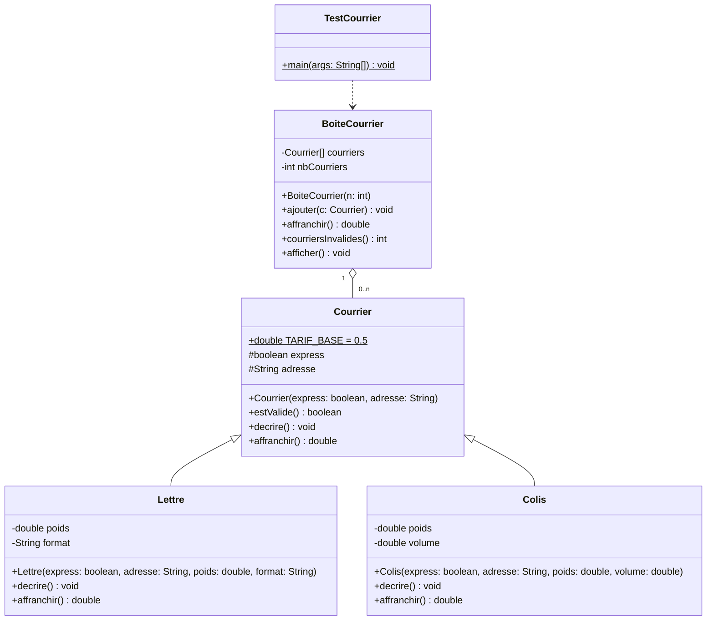

# TP 2 :Exercice 2 : Gestion des courriers

Nom et prénom :Eya kassraoui

 Diagramme de classes UML

## Formules d'affranchissement

| Type | Montant (normal) | Express |
|------|------------------|---------|
| Courrier | 0.5 | × 2 |
| Lettre | 2.50 (A4) ou 3.50 (A3) + 0.5 × poids (kg) | × 2 |
| Colis | 0.25 × volume (L) + poids (kg) × 1.0 | × 2 |

Un courrier invalide (adresse nulle) a un montant d'affranchissement nul.
