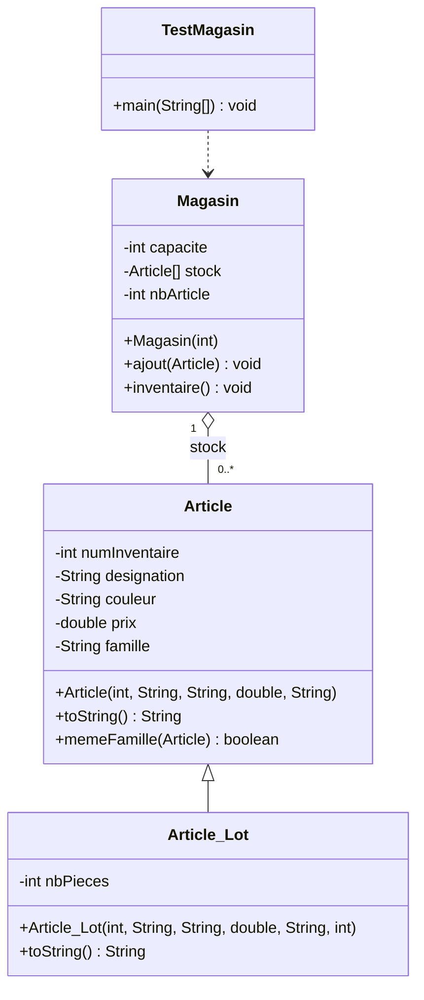

# TP 2 : Héritage et Polymorphisme — Exercice 1 : Gestion de magasin

**Nom et prénom :** _à compléter_

## Diagramme de classes UML



## Compilation et exécution

```bash
javac *.java
java TestMagasin
```
